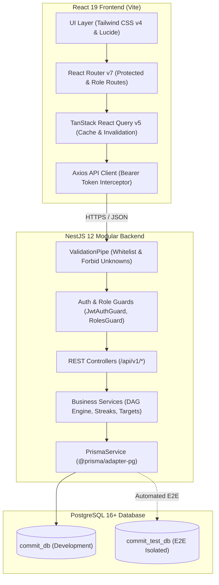
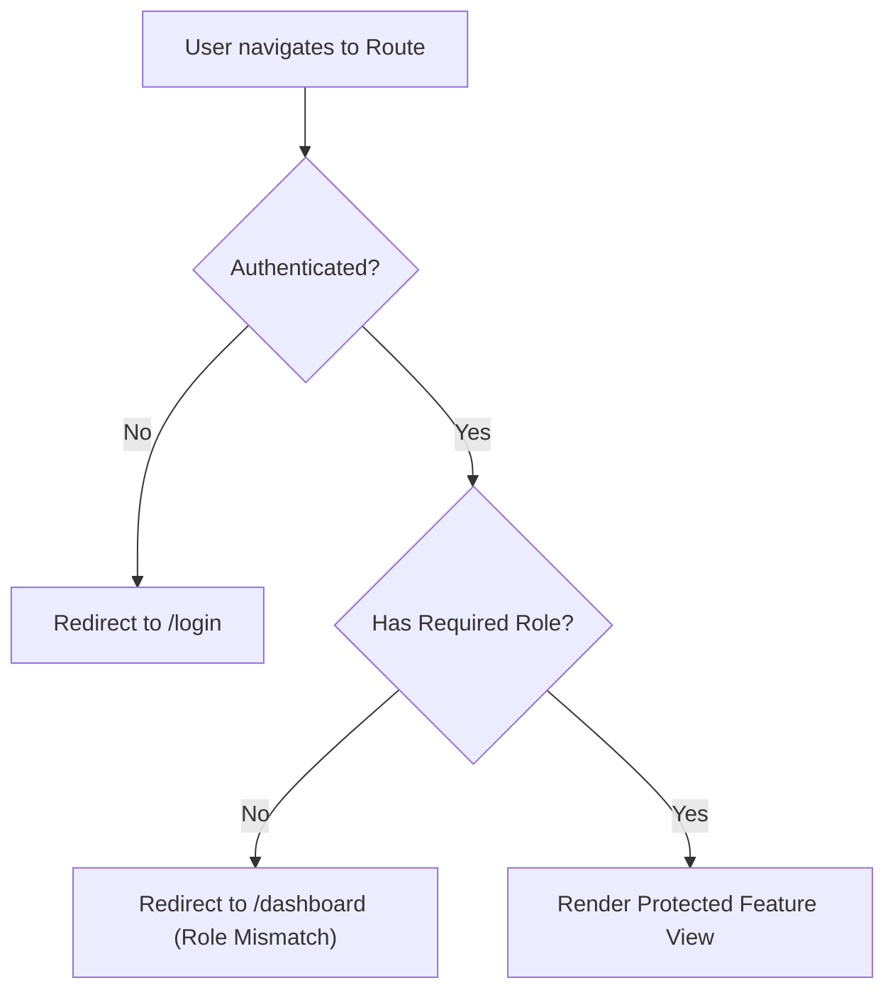
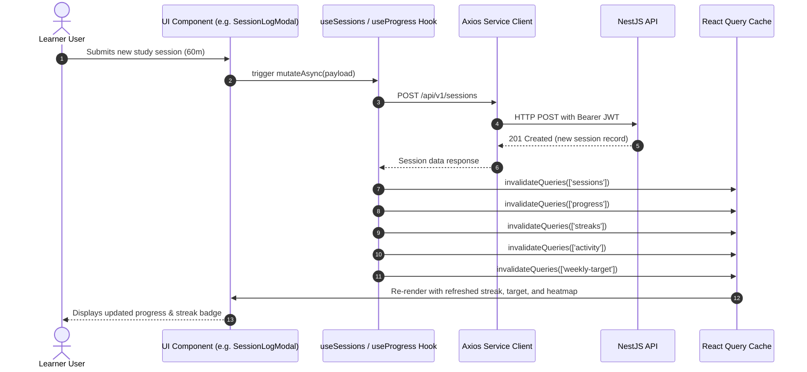
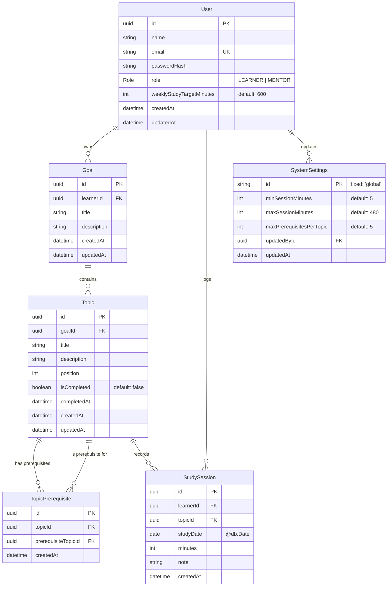
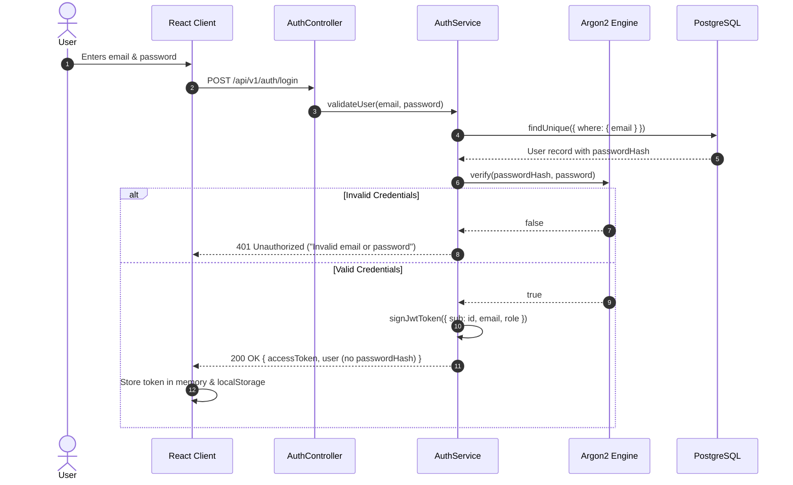
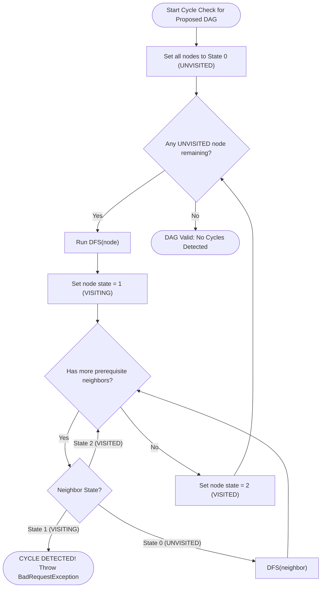
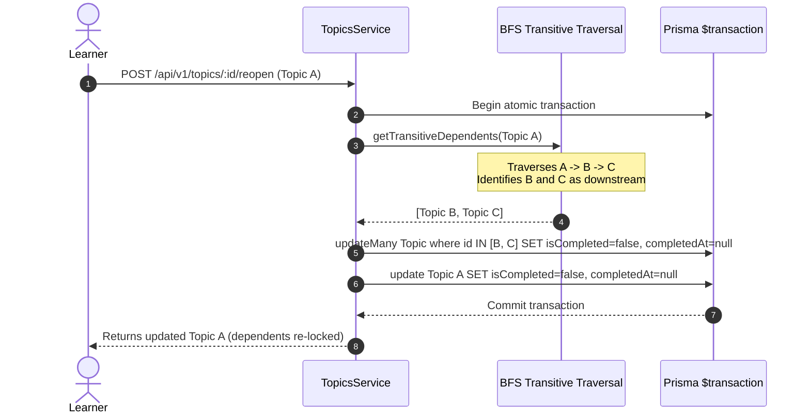
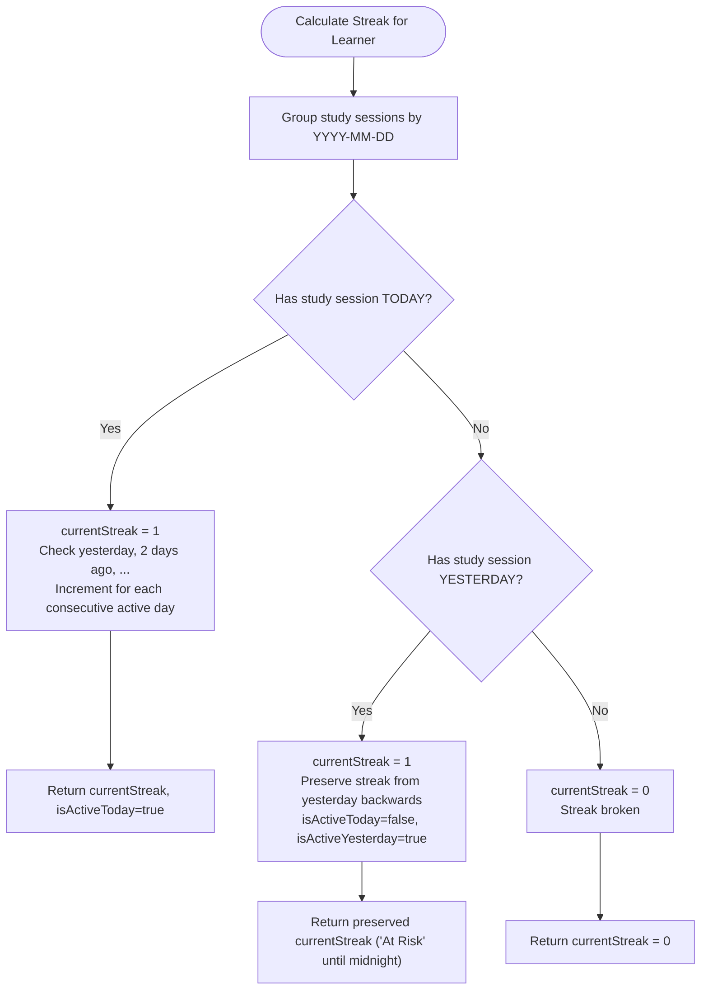
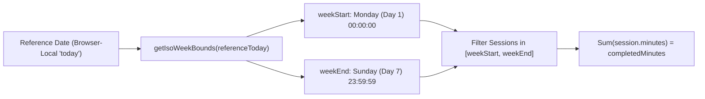

# Commit Architecture & Technical Design

Full technical architecture documentation for **Commit**, a study progress tracking platform with prerequisite graph enforcement, dynamic unlocking, cascading re-locking, study streaks, and weekly targets.

---

## 1. System Overview & High-Level Architecture

Commit follows a modern, decoupled client-server architecture:
- **Frontend**: Single Page Application (SPA) built with React 19, TypeScript, Vite, Tailwind CSS v4, and TanStack React Query v5.
- **Backend**: Modular RESTful API built with NestJS 12, TypeScript, Passport JWT authentication, class-validator validation, and OpenAPI Swagger documentation.
- **Data Persistence**: PostgreSQL 16+ accessed through Prisma 7.10.1 ORM with the `@prisma/adapter-pg` driver adapter.



---

## 2. React Frontend Architecture

The frontend is organized by feature domains with shared layout and primitive UI components.

### 2.1 Directory Structure
```text
frontend/src/
├── app/
│   ├── providers/          # AuthProvider, QueryClientProvider
│   └── router/             # ProtectedRoute, RoleRoute, route definitions
├── components/
│   ├── layout/             # AppLayout, Sidebar, Navbar, Breadcrumbs
│   └── ui/                 # Button, Input, Modal, Card, StatCard, Badge, DatePicker, etc.
├── features/
│   ├── auth/               # LoginForm, RegisterForm, AuthContext
│   ├── dashboard/          # LearnerDashboard, StudyTimeline, WeeklyActivityChart
│   ├── goals/              # GoalListPage, GoalDetailPage, GoalCard, GoalModal
│   ├── topics/             # TopicCard, PrerequisiteBadge, TopicModal, ReorderModal
│   ├── sessions/           # SessionHistoryPage, SessionLogModal, SessionFilters, SessionTable
│   ├── progress/           # ProgressPage, ActivityHeatmap, StreakSummary, WeeklyTargetCard, EditWeeklyTargetModal
│   ├── mentor/             # MentorDashboard, LearnerListPage, LearnerDetailPage, MentorGoalsPage, MentorSessionsPage
│   └── settings/           # SettingsPage (System settings administration)
├── hooks/                  # Custom React Query hooks (useProgress, useSessions, useGoals, useTopics, etc.)
├── services/               # Axios API clients (api.ts, auth, goals, topics, sessions, progress, mentor, settings)
├── types/                  # TypeScript interfaces and domain models
└── utils/                  # Date formatters, Zod schemas, localStorage helpers
```

### 2.2 Client-Side Route Protection
Route protection is layered across authentication and role authorization:



1. **`ProtectedRoute`**: Verifies JWT existence and active session in `AuthContext`. Unauthenticated users are redirected to `/login` with location preservation.
2. **`RoleRoute`**: Verifies role permissions (`Role.LEARNER` or `Role.MENTOR`). Learners cannot view mentor cohort pages; mentors navigating to learner-only creation routes are redirected to the mentor dashboard.

### 2.3 React Query State Management & Cache Invalidation
TanStack React Query v5 acts as the server-state manager. When mutations occur, queries are deterministically invalidated to maintain cache coherence:



---

## 3. NestJS Backend Architecture

The backend follows NestJS modular architecture with separation of concerns between HTTP controllers, business logic services, data access layer, and global security interceptors.

```text
backend/src/
├── common/
│   ├── decorators/         # @CurrentUser, @Roles, @Public
│   ├── filters/            # Global HttpExceptionFilter
│   ├── guards/             # JwtAuthGuard, RolesGuard
│   └── pipes/              # ParseUUIDPipe
├── config/                 # Environment validation via class-validator
├── prisma/                 # PrismaModule, PrismaService
├── auth/                   # Authentication, Argon2 hashing, JWT strategy
├── users/                  # User profile management
├── goals/                  # Learning goals CRUD and ownership enforcement
├── topics/                 # Topics CRUD, DAG prerequisite engine, cycle detection, re-locking
├── sessions/               # Study sessions logging, filtering, duration validation
├── progress/               # Progress summaries, 365-day heatmap, streaks, weekly targets
├── mentor/                 # Cohort inspection, student summaries, cross-student views
├── settings/               # System-wide configuration (min/max duration, max prerequisites)
├── app.module.ts           # Root application module
└── main.ts                 # Bootstrap entrypoint (CORS, Swagger, validation pipes)
```

### 3.1 Request Lifecycle Pipeline
Every inbound HTTP request traverses the following lifecycle pipeline:

```mermaid
flowchart LR
    Client["HTTP Request"] --> CORS["CORS Origin Validation"]
    CORS --> Pipe["Global ValidationPipe (whitelist: true, forbidNonWhitelisted: true)"]
    Pipe --> JwtGuard["JwtAuthGuard (Passport JWT Strategy)"]
    JwtGuard --> RolesGuard["RolesGuard (@Roles: LEARNER / MENTOR)"]
    RolesGuard --> Controller["Controller Route Handler"]
    Controller --> Service["Domain Service (Business Rules & Graph Engine)"]
    Service --> Prisma["Prisma 7 Client (@prisma/adapter-pg)"]
    Prisma --> DB[("PostgreSQL Database")]
```



---

## 4. PostgreSQL & Prisma Data Layer

The database schema is defined in [`backend/prisma/schema.prisma`](../backend/prisma/schema.prisma).

### 4.1 Entity Relationship Diagram



### 4.2 Relational Integrity & Cascades
- **Unique Constraints**:
  - `User.email`: Enforces distinct user identities.
  - `TopicPrerequisite(topicId, prerequisiteTopicId)`: Prevents duplicate prerequisite edges.
- **Cascading Deletions**:
  - Deleting a `Goal` automatically cascades to delete all child `Topic` records.
  - Deleting a `Topic` automatically removes all associated `TopicPrerequisite` rows and `StudySession` logs.
  - Deleting a `User` cascades to all owned goals, topics, and study sessions.

---

## 5. Authentication & Authorization Flows

### 5.1 Authentication (Argon2id & JWT)
All user passwords are encrypted using salted **Argon2id** (`argon2.argon2id`) with memory cost of 64MB (65,536 KiB), 3 iterations, and parallelism of 4.



### 5.2 Role Escalation Prevention
- **Registration**: The registration DTO strictly disallows any role specification. Requests attempting to pass `role: "MENTOR"` or `role: "LEARNER"` are rejected with `HTTP 400 Bad Request` by NestJS `forbidNonWhitelisted: true`.
- **User Modification**: The `PATCH /api/v1/users/me` endpoint only permits updating `name`. Attempting to supply `role` or `email` triggers HTTP 400 rejection.

### 5.3 Authorization & Data Isolation
Authorization is verified across two boundaries:
1. **Role-Based Guards (`RolesGuard`)**:
   - `Role.LEARNER`: Allowed to create and manage own goals, topics, sessions, and weekly targets. Forbidden from modifying system settings (HTTP 403).
   - `Role.MENTOR`: Allowed to update global system settings (min/max duration, max prereqs). Forbidden from mutating learner records (HTTP 403).
2. **Resource Ownership Isolation**:
   - Every learner endpoint strictly enforces `record.learnerId === currentUser.id`.
   - Attempting to inspect or modify another learner's goal, topic, or study session produces `HTTP 403 Forbidden` (`"Learners cannot access another learner's study session"`).

---

## 6. Prerequisite DAG Engine & Graph Integrity

The prerequisite relationship between topics inside a goal forms a **Directed Acyclic Graph (DAG)**.

### 6.1 Validation Rules
Whenever a topic is created or updated with prerequisites:
1. **Self-Dependency Rejection**: A topic cannot depend on itself ($A \to A$).
2. **Duplicate Edge Rejection**: Duplicate prerequisite IDs in a single topic are rejected.
3. **Capacity Limit**: Prerequisite count cannot exceed `SystemSettings.maxPrerequisitesPerTopic` (default 5).
4. **Goal Boundary Constraint**: All prerequisite topics must belong to the exact same `goalId`. Cross-goal dependencies are strictly rejected.
5. **Cycle Detection (DFS)**: Any directed cycle ($A \to B \to A$ or $A \to B \to C \to A$) is rejected.

### 6.2 3-State DFS Cycle Detection Algorithm
The cycle detection algorithm constructs an adjacency list representing all existing edges in the goal plus the proposed modifications, then executes a 3-color Depth First Search:
- `0 (UNVISITED)`: Node not yet examined.
- `1 (VISITING)`: Node currently in the active DFS recursion stack. If an edge points to a node in this state, **a back-edge exists, proving a directed cycle**.
- `2 (VISITED)`: Node and all downstream descendants fully verified acyclic.



---

## 7. Dynamic Topic Unlocking & Cascading Re-locking

### 7.1 Dynamic Unlocking
Topics are dynamically enriched upon retrieval:
- `isUnlocked = (prerequisites.filter(p => !p.isCompleted).length === 0)`
- `missingPrerequisites = [{ id, title }, ...]` for all incomplete prerequisites.

A learner cannot complete a topic if any prerequisite is incomplete:
```typescript
if (dto.isCompleted === true && !topic.isCompleted) {
  const incompletePrereq = topic.prerequisites.find(
    (p: any) => !p.prerequisiteTopic?.isCompleted,
  );
  if (incompletePrereq) {
    throw new BadRequestException(
      'Cannot complete a topic whose prerequisites are not yet completed',
    );
  }
}
```

### 7.2 Cascading Dependent Re-locking
When an already-completed topic is reopened (`isCompleted: false`), all downstream completed topics that transitively depend upon it would be left in an inconsistent state. The engine executes a breadth-first search (BFS) downstream traversal inside an atomic Prisma database transaction to reset downstream topics:



---

## 8. Study Streak & Activity Heatmap Logic

### 8.1 Calendar-Day Normalization (Zero Timezone Shift)
All study sessions store their date as `@db.Date` in PostgreSQL. All calculations operate purely on nominal calendar date strings (`YYYY-MM-DD`), preventing time-of-day offsets or daylight saving jumps from altering streaks:
- `shiftCalendarDate(dateStr, +/- days)`
- `getCalendarDaysDiff(earlier, later)`
- `extractNominalDate(Date)`

### 8.2 Streak Calculation with "Yesterday Preservation"
Learners retain their active streak throughout the current calendar day even before logging their first session of the day:



### 8.3 Activity Heatmap Matrix & Intensities
The trailing 365-day activity heatmap aggregates session duration per calendar day and assigns discrete visual intensity levels:

| Level | Range (Minutes) | Hex Color | Visual Style | Role / Label |
|:---:|:---:|:---:|:---|:---|
| **0** | `0 min` | `#F0EFEA` | `bg-[#F0EFEA] border-[#E4E2DE]` | Neutral / Inactive |
| **1** | `1 – 29 min` | `#DDDDF8` | `bg-[#DDDDF8] border-[#C4C5F0]` | Light review (<30m) |
| **2** | `30 – 59 min` | `#ACAEF0` | `bg-[#ACAEF0] border-[#8E91E2]` | Moderate study (30m–1h) |
| **3** | `60 – 119 min` | `#7375D8` | `bg-[#7375D8] border-[#5557C8]` | High study velocity (1h–2h) |
| **4** | `120+ min` | `#4446B4` | `bg-[#4446B4] border-[#36389A]` | Deep focus study (2h+) |

- Matrix layout: 7 rows corresponding to Monday through Sunday.
- Bounded date range: Maximum 366 calendar days.
- Inverted ranges (`startDate > endDate`) rejected with HTTP 400.

---

## 9. Weekly Study Target Calculation

Each learner has a configurable weekly target stored in `User.weeklyStudyTargetMinutes` (default: 600 minutes / 10 hours).

### 9.1 ISO-8601 Monday–Sunday Reporting Boundaries
Weekly progress is computed strictly between Monday 00:00:00 and Sunday 23:59:59 of the reference week:



### 9.2 Metric Formulas
$$\text{completedMinutes} = \sum_{s \in \text{WeekSessions}} s.\text{minutes}$$
$$\text{remainingMinutes} = \max(0, \text{weeklyStudyTargetMinutes} - \text{completedMinutes})$$
$$\text{percentage} = \min\left(100, \text{round}\left(\frac{\text{completedMinutes}}{\text{weeklyStudyTargetMinutes}} \times 100\right)\right)$$
$$\text{isTargetMet} = \text{completedMinutes} \ge \text{weeklyStudyTargetMinutes}$$

### 9.3 Validation Constraints
- Target range: Strictly bounded between **60 minutes** (1 hour) and **4,200 minutes** (70 hours).
- Value must be an integer.
- Mentor accounts are strictly forbidden from modifying learner targets (`HTTP 403 Forbidden`).

---

## 10. Summary of Architectural Guarantees

1. **Strict Zero-Trust Role Boundaries**: Mentors can inspect learner metrics cohort-wide but can never mutate learner curricula, sessions, or targets.
2. **Deterministic Graph Integrity**: Cycle detection ensures the prerequisite structure remains a strict DAG.
3. **Atomic Consistency**: Cascading dependent re-locking executes within atomic PostgreSQL transactions (`prisma.$transaction`).
4. **Timezone-Agnostic Analytics**: Streak and activity metrics operate on nominal calendar days, ensuring zero UTC drift across midnight.
5. **Real-Time Client Coherence**: React Query cache invalidations guarantee immediate UI synchronization upon logging, completing, reopening, or editing study activities.
